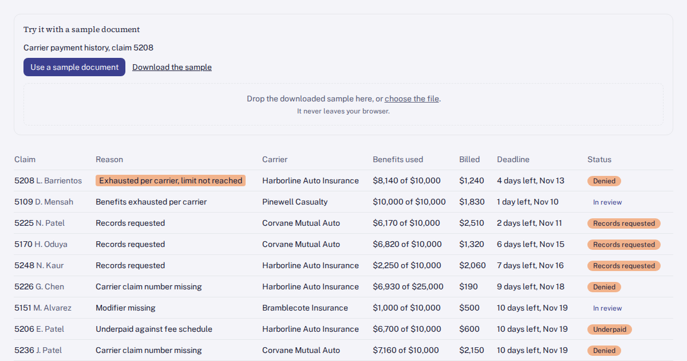

# PIP claim and denial tracker for an injury practice

Every PIP claim tracked from submission to payment, with denials sorted by reason, appeal deadlines counted down, and nothing sent to a carrier, the LOP side or an attorney without a person's approval.

## What's new

The tracker now has a Follow-up queue and a Ledgers at MMI screen. Follow-up lists every denied, underpaid and records-requested PIP claim, plus pending claims with no payment after 30 days, sorted with the oldest next follow-up first. From there you can confirm carrier receipt or set the next follow-up. Ledgers at MMI prepares the final itemized bill and ledger when a patient reaches maximum medical improvement, and holds attorney reduction requests in a "Waiting for Dr. Castell" queue until the physician approves or declines them.

## Who has this problem

Injury-first practices: orthopedics, spine, pain management, physiatry and physical therapy, paid mostly through PIP, letters of protection and workers' comp. The PI billing lead at a multi-clinic practice works about 140 PIP claims and carrier remittances a week.

EOBs arrive through carrier portals, the clearinghouse and paper mail. Each one is matched to its claim by hand and typed into a spreadsheet. Appeal and timely filing deadlines live in a second tab that has to be re-sorted by hand, so one missed re-sort can lose a claim. Exhaustion notices are accepted at face value. Balances move to the LOP coordinator with no claim history attached. At MMI, the final ledger is assembled by hand, and attorney reduction requests sit in email with no verified balance for the physician.

At about 14 minutes per claim or remittance, 140 a week is roughly 33 billing hours a week. One wrongly accepted exhaustion notice moves $1,860 from a payment due in weeks to a lien that waits a median of about 440 days for settlement.

## What you can try

- Open the newest claim: on Claims, click the top row to see its history.
- Check the exhaustion denial: on Denials, open claim 5208, attach the carrier payment history ($8,140 paid of a $10,000 limit), then click Move to reconsideration review.
- Send a reduction to the physician: on Ledgers at MMI, open case 3312 and send the attorney's request to settle the $4,620 balance for $3,000 to Dr. Castell with the verified balance.
- Approve the reconsideration: on Review, read the drafted letter for claim 5208 and click Approve and send to adjuster.

The Start here screen ticks off each task as you finish it, and Reset puts the demo back to its starting data.

**Follow-up queue:** open a row to see the open balance and the last adjuster contacts, then confirm carrier receipt or set the next follow-up 7 days out.

**Sample documents:** a carrier payment history for claim 5208 and an attorney reduction request for case 3312. Use them in the app or download them and upload the file.

**Role switcher:** view the app as the PI billing lead, the lien and LOP coordinator or an attorney, with fields such as diagnosis codes and adjuster names hidden from the roles that should not see them.

**Cost calculator:** put in your own weekly claim volume, minutes per claim and billing rate to compare today's time cost with the tracker.

**How it works:** a clickable diagram. Click any box to see what it does, what data passes through it and whether it stores patient data.

## How it's built

A browser-only React + TypeScript + Tailwind app built on the Umakes kit, running on synthetic seed data: 160 PIP claims across five invented auto carriers, 240 adjuster contacts and 36 MMI ledgers. It was built and checked by the Umakes App Factory, with automated gates plus a reviewer that uses the app the way a visitor would. The architecture screen shows how a real version would connect the practice billing system (Practice Mate), the clearinghouse (Office Ally), carrier portals and mailed EOBs, a document reader for scanned EOBs and attorney letters, and the people who approve each step.

## What a production version adds

- Real integrations: claims, payments and ledgers from Practice Mate, electronic remittances from Office Ally, and scanned EOBs, carrier notices and reduction letters read by a document reader that sees letter text only, never chart notes.
- HIPAA controls: access limited by role, every action kept in an audit log, patient data encrypted at rest and in transit, and no patient data sent to a model without a signed BAA.
- Deployment on the client's own cloud (GCP), not ours.
- Client ownership: the practice owns the code, the data and the deployment.

## Try it

https://umakescloud-max.github.io/pip-claim-denial-tracker-v1/

This is a concept prototype built on synthetic data. No real patients, carriers or law firms are in it. A real build runs on the client's own cloud, is HIPAA-ready, and belongs to the client.

If your team fights this every week, book a free workflow audit at umakes.cloud or reply to umakescloud@gmail.com.
